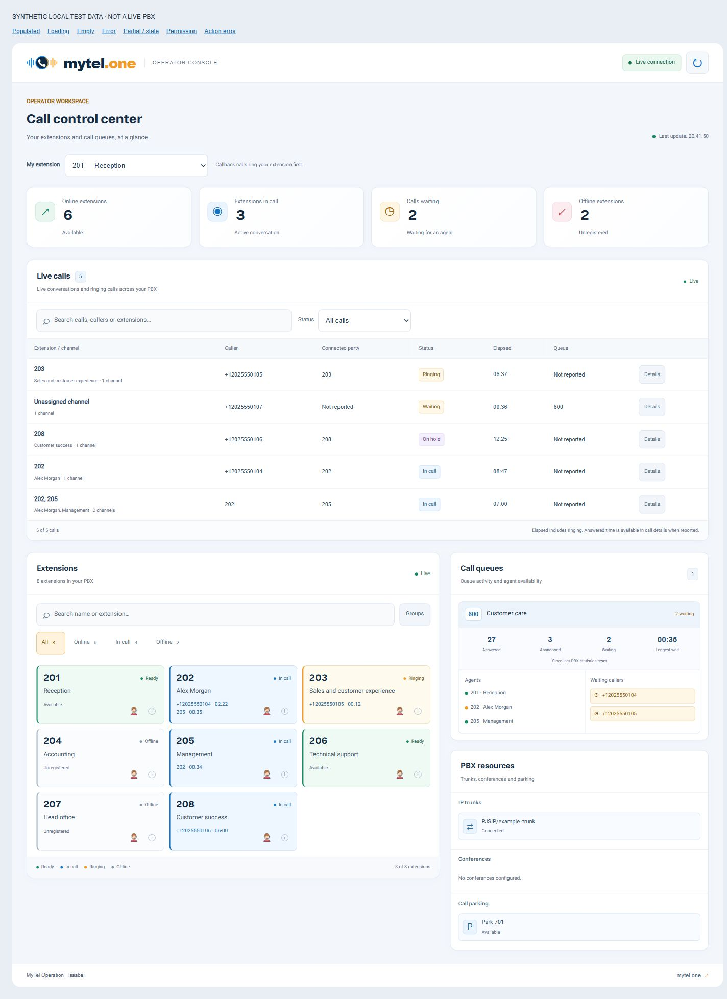

# MyTel Operation Panel for Issabel

<p align="center"></p>

پنل مانیتورینگ و اپراتوری ایزابل با هویت بصری [MyTel.one](https://mytel.one)، رابط فارسی راست‌به‌چپ و نسخهٔ انگلیسی.

A responsive operator console for Issabel 5, with a white interface, MyTel blue and amber accents, live PBX snapshots, extension search and status filters. English is the default; an optional Persian RTL variant is included.



The preview contains synthetic test data. Live information comes from your own PBX.

## نصب نسخهٔ انگلیسی

روی سرور ایزابل با کاربر `root` اجرا کنید. ریپو عمومی است و نصب به توکن GitHub نیاز ندارد:

```bash
curl -fL --retry 3 -o /root/mytel-operation-install.sh \
  https://raw.githubusercontent.com/mytel-one/MyTell-Operation-Issabel-Pannel/v2.0.0/install.sh
bash /root/mytel-operation-install.sh --ref v2.0.0 --lang en
```

سپس در ایزابل از منوی **PBX → MyTel Operation** وارد شوید؛ آدرس مستقیم:

```text
https://YOUR-ISSABEL/index.php?menu=control_panel
```

ورود و سطح دسترسی از حساب‌های موجود ایزابل استفاده می‌کند. رمز یا حساب پیش‌فرض جدیدی ساخته نمی‌شود.

## Language selection

English is the default. To select the optional Persian RTL interface instead:

```bash
bash /root/mytel-operation-install.sh --ref v2.0.0 --lang fa
```

For an extracted release or checkout, the installer resolves the package relative to its own location:

```bash
bash /path/to/MyTell-Operation-Issabel-Pannel/install.sh --check
bash /path/to/MyTell-Operation-Issabel-Pannel/install.sh --lang en
```

`--check` performs preflight checks without installing. Run `bash install.sh --help` for all options. English is the unattended default.

## امکانات

- طراحی سفید اختصاصی مایتل، رابط پیش‌فرض انگلیسی و چیدمان واکنش‌گرا.
- نمایش داخلی‌ها، صف‌ها، ترانک‌ها، کنفرانس و پارکینگ تماس بر اساس تنظیمات واقعی PBX.
- جست‌وجوی نام و شمارهٔ داخلی و فیلتر وضعیت.
- فهرست تماس‌های جاری و جزئیات چند تماس هم‌زمانِ هر داخلی، بر اساس دادهٔ واقعی Asterisk.
- نمایش جداگانهٔ زمان ایجاد کانال و مدت پاسخ‌گویی، همراه با مشخص‌کردن اطلاعات ناموجود.
- فضای جزئیات داخلی، انتخاب داخلی اپراتور و کنترل‌های تماس احراز هویت‌شده.
- وضعیت اتصال، زمان آخرین دریافت اطلاعات و تلاش مجدد پس از قطع ارتباط.
- حفظ آخرین داده‌های دریافتی هنگام اختلال، با علامت‌گذاری وضعیت اتصال.
- نگهداری چیدمان و گروه‌بندی داخلی‌ها در دیتابیس موجود ایزابل.
- نصب همراه با پشتیبان‌گیری و بازگردانی خودکار در صورت شکست ثبت منو.

See the [operator guide](docs/OPERATOR_GUIDE.md) for live-call semantics, queue counters and call controls.

## Installation and recovery

The installer validates the Issabel tree, PHP capabilities and source syntax before replacing the module. It creates a root-only backup of the previous module and the menu, ACL and layout databases before changing them. Existing AMI configuration and layout data are preserved. The install log prints the exact backup path and outcome; failed menu registration returns an error and triggers rollback.

The module is installed into `/var/www/html/modules/control_panel`. No Asterisk or SIP configuration change is required, and the installer does not restart Asterisk.

Before a manual rollback, close panel tabs and retain the current backup. Follow the restore instructions saved in the installer backup directory. Restoring an older ACL or menu database can also revert unrelated changes made after that backup; use the backup from the immediately preceding installation.

## Compatibility and verification

Target acceptance is recorded in [the release verification report](docs/releases/2.0.0/verification.md). The verified target is Issabel 5 on Rocky Linux 8.10, PHP 7.4 and Asterisk 20. Other versions require their own acceptance check.

No application can be certified free of every possible bug. Automated regressions and target checks document the behavior actually exercised; real handset audio and production call-control workflows require suitable test extensions.

Run the independent test suites from the repository root:

```bash
php tests/backend_regressions.php control_panel
php tests/backend_regressions.php control_panel_en
php tests/backend_live.php control_panel
php tests/backend_live.php control_panel_en
php tests/snapshot_startup.php control_panel
php tests/snapshot_startup.php control_panel_en
node --test tests/*.cjs
sudo python3 -m unittest discover -s tests -p 'installer_test.py' -v
bash -n install.sh
```

Installer integration tests use a temporary filesystem and a fake menu merger; they never point to the live module. PHP and Node tests use isolated PBX doubles rather than live call-control actions.

For a populated visual fixture, run `python3 tests/ui-preview.py`, serve this checkout on loopback, and open `/artifacts/ui/preview.html?state=connected`. The fixture uses synthetic data and mocked call actions. `tests/ui-browser-checks.js` contains browser assertions restricted to that local fixture; never run action tests against a production panel.

## Security and operation

- Keep the panel behind the same trusted network and HTTPS access as Issabel.
- Access follows the `control_panel` ACL resource. Only administrators receive the menu grant at installation.
- State-changing requests require POST, a session CSRF token and bounded parameters.
- Caller, extension and queue text is treated as untrusted input.
- No GitHub token is needed at runtime. Never commit PBX credentials or installation backups.

## Credits and license

This is a modified distribution of [IssabelCallMonitoring / voiz-issabel-monitoring](https://github.com/voipiran/voiz-issabel-monitoring), developed by Hamed Koohfallah / VOIPIRAN, building on the PaloSanto/Issabel operator module. Existing source copyright and GPL notices are retained.

MyTel modifications dated **2026-11-18** include the bilingual visual redesign, installation/recovery changes and runtime/security fixes. See [CHANGELOG.md](CHANGELOG.md) and [the test evidence](docs/releases/2.0.0/verification.md).

The module is distributed under [GPL-2.0](LICENSE), without warranty. Bundled open fonts retain their own OFL notices. MyTel branding identifies this distribution and does not replace the upstream authorship notices.
